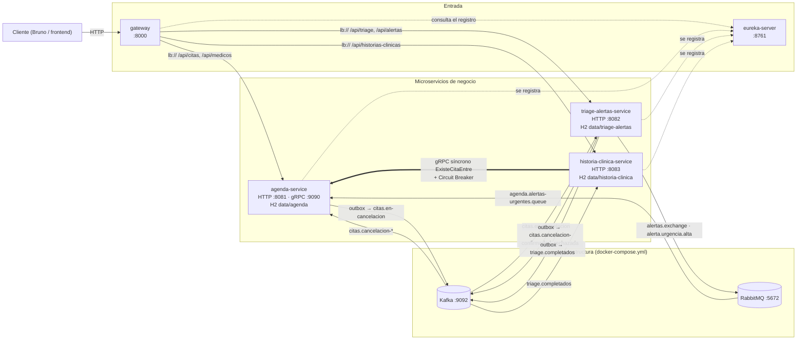

# Arquitectura (tal como está construida) · G2 Telemedicina con triage y alertas

Este documento describe la arquitectura **que existe en el commit del corte**: tres microservicios de
negocio, un API Gateway y un registro de servicios, comunicados por gRPC, Kafka y RabbitMQ. Lo que no
está implementado aparece marcado como **Propuesta**, nunca como hecho.

## 1. Contexto

La plataforma permite que un paciente agende una cita de telemedicina, responda un cuestionario de
triage antes de la consulta y que, si la urgencia es alta, se genere una alerta clínica que prioriza
su cita. El médico solo puede abrir la historia clínica de un paciente con el que tiene una cita activa
o histórica, y no puede iniciar la consulta si el triage no está completado. El caso completo está en
[CASO.md](CASO.md).

Requisito no funcional que guía la descomposición: **el agendamiento debe seguir funcionando aunque el
módulo de alertas esté caído**. Por eso Agenda no depende en tiempo de ejecución de Triage ni de Historia.

## 2. Diagrama de componentes

Cada caja de servicio corresponde a una carpeta del repositorio: `gateway/`, `eureka-server/`,
`agenda-service/`, `triage-alertas-service/` e `historia-clinica-service/`. Kafka y RabbitMQ son
contenedores declarados en `docker-compose.yml`. La carpeta `telemedicina/` es el **monolito modular
original** (talleres de DDD y hexagonal); se conserva como referencia y no participa en el despliegue.

## 3. Servicios

| Servicio | Bounded context | Responsabilidad | Persistencia propia |
|---|---|---|---|
| `agenda-service` | Agenda | Agendar, reprogramar y cancelar citas; agenda del día; expone `ExisteCitaEntre` por gRPC; prioriza citas con alerta urgente | H2 en archivo `data/agenda` + tabla outbox |
| `triage-alertas-service` | Triage y alertas | Cuestionario de triage, clasificación baja/media/alta, alerta clínica, panel de alertas activas | H2 en archivo `data/triage-alertas` + tabla outbox |
| `historia-clinica-service` | Historia clínica | Historia del paciente, acceso auditado por médico, registro de consulta (solo con triage completado) | H2 en archivo `data/historia-clinica` + proyección de triages completados |
| `gateway` | — | Punto de entrada único; enruta por prefijo a cada servicio por su nombre en Eureka | — |
| `eureka-server` | — | Registro de servicios | — |

Todos los servicios de negocio siguen la misma arquitectura hexagonal por capas: `dominio/` (agregados,
value objects, factories y reglas), `aplicacion/` (casos de uso y puertos) e `infraestructura/`
(adaptadores de entrada web, gRPC y mensajería; adaptadores de salida JPA, gRPC, Kafka y RabbitMQ).

## 4. Comunicación entre servicios y por qué

| Conexión | Tipo | Mecanismo | Justificación | ADR |
|---|---|---|---|---|
| Historia → Agenda | **Síncrona** | gRPC `ExisteCitaEntre` con Circuit Breaker (Resilience4j) y deadline de 5 s | Dar acceso a una historia clínica es una regla de seguridad: la respuesta debe ser inmediata y actual; no se puede autorizar con un dato que "llegará luego" | [ADR-002](../adr/ADR-002-grpc-historia-agenda.md) |
| Triage → Historia | **Asíncrona** | Kafka `triage.completados` publicado desde outbox | Historia solo necesita saber, antes de la consulta, que el triage terminó; no debe caerse si Triage está caído | [ADR-003](../adr/ADR-003-kafka-outbox-saga.md) |
| Agenda ⇄ Triage (cancelación) | **Asíncrona** | Saga coreografiada sobre Kafka, outbox en ambos lados | Cancelar una cita con alerta urgente sin atender debe rechazarse, pero Agenda no puede bloquearse esperando a Triage | [ADR-003](../adr/ADR-003-kafka-outbox-saga.md) |
| Triage → Agenda (alerta urgente) | **Asíncrona** | RabbitMQ `alertas.exchange`, clave `alerta.urgencia.alta` | La alerta debe llegar en segundos; es una notificación, no una transacción | [ADR-004](../adr/ADR-004-rabbitmq-alertas.md) |
| Cliente → servicios | **Síncrona** | HTTP vía Gateway (`lb://`) | El cliente conoce un solo puerto (8000) | [ADR-005](../adr/ADR-005-gateway-eureka.md) |

## 5. Resiliencia y consistencia implementadas

- **Circuit Breaker** en `HistorialCitasGrpcAdapter` (ventana de 10 llamadas, 50 % de fallos, 10 s abierto).
- **Transactional Outbox** en Agenda y Triage: el evento se guarda en la misma transacción que el cambio
  de estado y un `OutboxPoller` lo publica en Kafka cada 2 s.
- **Saga coreografiada** de cancelación con **compensación**: si Triage rechaza, la cita vuelve a su
  estado anterior.
- **Consumidor idempotente** de `triage.completados` (`TriagesCompletadosJpaAdapter`): un evento repetido
  no duplica la proyección.
- **Database per Service**: cada servicio tiene su propia base H2 en archivo, sin tablas compartidas.

## 6. Decisiones (ADR)

| ADR | Decisión | Estado |
|---|---|---|
| [ADR-001](../adr/ADR-001-descomposicion-microservicios.md) | Descomponer en 3 microservicios por bounded context con base de datos propia | Aceptada (implementada) |
| [ADR-002](../adr/ADR-002-grpc-historia-agenda.md) | gRPC síncrono con Circuit Breaker de Historia a Agenda | Aceptada (implementada) |
| [ADR-003](../adr/ADR-003-kafka-outbox-saga.md) | Kafka con Outbox y Saga coreografiada | Aceptada (implementada) |
| [ADR-004](../adr/ADR-004-rabbitmq-alertas.md) | RabbitMQ para alertas urgentes, envío directo sin outbox | Aceptada (implementada) |
| [ADR-005](../adr/ADR-005-gateway-eureka.md) | API Gateway con descubrimiento en Eureka | Aceptada (implementada) |
| [ADR-006](../adr/ADR-006-propuesta-observabilidad.md) | Observabilidad con Actuator y Correlation-Id | **Propuesta** (no implementada) |
| [ADR-007](../adr/ADR-007-propuesta-dlt-reintentos.md) | Dead Letter Topic y reintentos con backoff en consumidores Kafka | **Propuesta** (no implementada) |

## 7. Despliegue

`docker-compose.yml` levanta Kafka, RabbitMQ, Eureka, los tres servicios y el Gateway. El `Dockerfile`
de la raíz es multi-etapa y compila cualquier servicio con el argumento `SERVICE`. Las instrucciones de
arranque y una petición que cruza dos servicios están en el [README](../../README.md).

## 8. Lo que no está construido (Propuesta)

- **Propuesta:** observabilidad (Actuator, Correlation-Id en logs y eventos) — ADR-006.
- **Propuesta:** Dead Letter Topic y reintentos con backoff — ADR-007.
- **Propuesta:** consumidor propio de enfermería para las alertas de RabbitMQ. Hoy la única cola enlazada
  es la de Agenda; enfermería consulta el panel `GET /api/alertas/activas`.
- **Propuesta:** CQRS con un modelo de lectura separado para el panel de alertas y la agenda del día.
- **Propuesta:** integración continua (pipeline que ejecute `mvnw test` por servicio).
